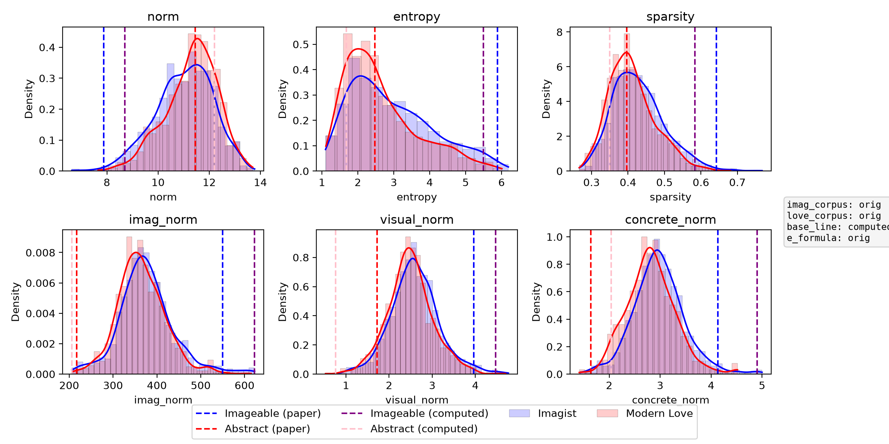

<!--
How to cite in this report. Every citation is an ordinary Markdown link to a file in this repository:
  code or text lines   [label](../experiment_3.py#L172)   or a range: #L171-L173
  paper passage        [label](paper/Encoding_Imagism.pdf#page=9 "exact words to highlight on that page")
  data rows            [label](../data/measures/imag_orig_love_orig_base_computed_entropy_orig_metrics.csv#L2-L6)   (line 1 is the header row)
  figure               [label](../figs/imag_orig_love_orig_base_computed_entropy_orig.png)
Folders: everything except the report lives in the repository root (../): the paper's code, plus
experiment_3_replication_commented.py and run_grid.py, which write to ../data/, ../figs/ and ../results/.
Links to anything else (https://...) open normally.
-->

# Experiment III: Imagist vs Modern Love poems

**Reproduction report** · Neil · draft

> **Dummy content.** Every paragraph below is placeholder text for testing the layout. The citations are real: they point at the right lines, rows, pages and figures. Hover over a citation to preview its source, and click it to open the source beside the report.

## 1. What they planned to do

*Placeholder:* one or two sentences on the goal of Experiment III, citing how the paper describes it ([literary case study, p. 3](paper/Encoding_Imagism.pdf#page=3 "We examine the discriminatory power of these embedding")) and where the section starts ([§6.3, p. 16](paper/Encoding_Imagism.pdf#page=16 "6.3 Experiment III: Comparing Poems")).

*Placeholder:* the two corpora and the promise to keep Imagist poets out of the Love set ([footnote 7, p. 9](paper/Encoding_Imagism.pdf#page=9 "To maintain clear genre distinctions, we excluded poets in Some Imagist Poets from the love-themed poetry")), and the unit of analysis, poem lines ([footnote 14, p. 18](paper/Encoding_Imagism.pdf#page=18 "we conduct our analysis at the poem-line level rather than at the poem level")).

## 2. What they actually did

*Placeholder:* how the Imagist poems are split into lines ([splitting on `*`](../experiment_3.py#L86-L96)) and what the first lines look like ([first Imagist lines](../data/measures/imag_orig_love_orig_base_computed_entropy_orig_metrics.csv#L2-L6)).

*Placeholder:* how entropy is computed in the code ([softmax entropy](../experiment_3.py#L30-L35)) compared with the definition in the paper ([entropy definition, p. 12](paper/Encoding_Imagism.pdf#page=12 "taking the absolute value of each dimension and normalizing to sum to 1")).

*Placeholder:* the statistical tests behind Table 6 ([t-test and Mann-Whitney U](../experiment_3.py#L339-L350)).

## 3. What they didn't do

*Placeholder:* the Bonferroni correction is computed but never reported ([Bonferroni block](../experiment_3.py#L352-L380)), and lines are treated as independent although they nest in poems ([line-level tests in the replication](../experiment_3_replication_commented.py#L525-L530)).

## 4. What went wrong

*Placeholder:* the author filter compares names by exact match ([author filter](../experiment_3.py#L171-L173)), so D. H. Lawrence ends up in both corpora ([Lawrence in the Love set, p. 27](paper/Encoding_Imagism.pdf#page=27 "Last Words to Miriam"); [Lawrence in the Imagist set, p. 28](paper/Encoding_Imagism.pdf#page=28 "Ballad of Another Ophelia"); [his Imagist lines](../data/measures/imag_orig_love_orig_base_computed_entropy_orig_metrics.csv#L837-L839)).

*Placeholder:* duplicate lines explain the line counts ([run log with line counts](../results/exp3_runs.jsonl#L1)), and the replication's de-duplication step is still commented out ([dedup](../experiment_3_replication_commented.py#L443-L445)).

## 5. Are the claims valid?

| Claim | Verdict | Evidence |
|---|---|---|
| Embedding metrics distinguish the two groups ([p. 19](paper/Encoding_Imagism.pdf#page=19 "embedding-based metrics do distinguish Imagist poetry")) | *Placeholder* | [tests in the replication](../experiment_3_replication_commented.py#L526-L541) |
| Separability holds under lexical control ([p. 20](paper/Encoding_Imagism.pdf#page=20 "genre-level separability even under lexical control")) | *Placeholder* | [dictionary scores](../experiment_3_replication_commented.py#L259-L263) |
| Imageability is shaped by composition, not only genre ([p. 19](paper/Encoding_Imagism.pdf#page=19 "Imageability is not merely a product of genre conventions")) | *Placeholder* | [distributions](../figs/imag_orig_love_orig_base_computed_entropy_orig.png) |

## 6. Extra experiments

*Placeholder:* which extra factors to test (author, vocabulary, genre), and the script that makes the derived tables and figures ([the grid in run_grid.py](../run_grid.py#L7-L10)).

## 7. How to read Figure 3 and Table 6

*Placeholder:* what the figure shows ([Figure 3 caption, p. 18](paper/Encoding_Imagism.pdf#page=18 "Figure 3: Imagist vs. love poems in terms of dictionary features and embedding-based metrics")), how the code draws it ([plotting code](../experiment_3.py#L313-L333)), and the redrawn version ([Figure 3 reproduced](../figs/imag_orig_love_orig_base_computed_entropy_orig.png)).

*Placeholder:* the two reference lines are hard-coded ([example lines](../experiment_3.py#L303-L305)), although the paper says they were among the top and bottom ten ([p. 18](paper/Encoding_Imagism.pdf#page=18 "two poem lines which were found among the top ten most imageable and bottom ten least imageable lines")). Their values are in the replication's metrics table: [“Homespun…”](../data/measures/imag_orig_love_orig_base_computed_entropy_orig_metrics.csv#L1435) and [“Of insidious intent”](../data/measures/imag_orig_love_orig_base_computed_entropy_orig_metrics.csv#L1818).

*Placeholder:* reading Table 6 ([Table 6 caption, p. 18](paper/Encoding_Imagism.pdf#page=18 "T-test and Mann-Whitney U results (for comparison) for dictionary-based features")) next to the effect sizes it leaves out ([Cohen's d and AUC](../experiment_3_replication_commented.py#L532-L541)) and the code that reproduces it ([tests](../experiment_3_replication_commented.py#L500-L545)).

## Sources

* Paper: Bizzoni, Feldkamp & Nielbo (2026), “Encoding Imagism?”, *Journal of Computational Literary Studies* 5(1) ([PDF](paper/Encoding_Imagism.pdf#page=1)).
* Original code and data: [centre-for-humanities-computing/imageability_jcls](https://github.com/centre-for-humanities-computing/imageability_jcls) at commit `531808f`, at the root of this repository.
